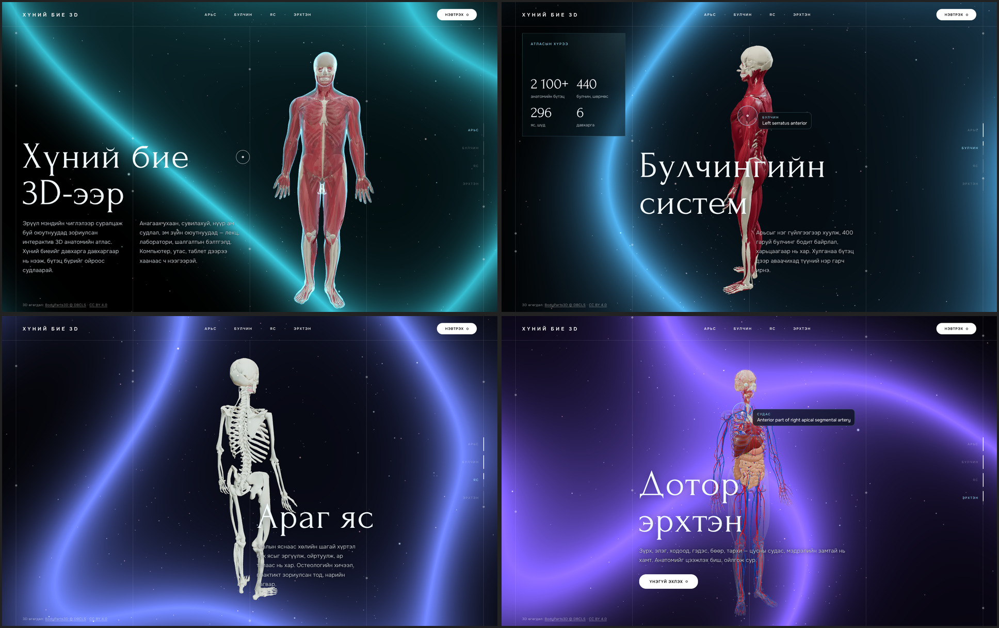
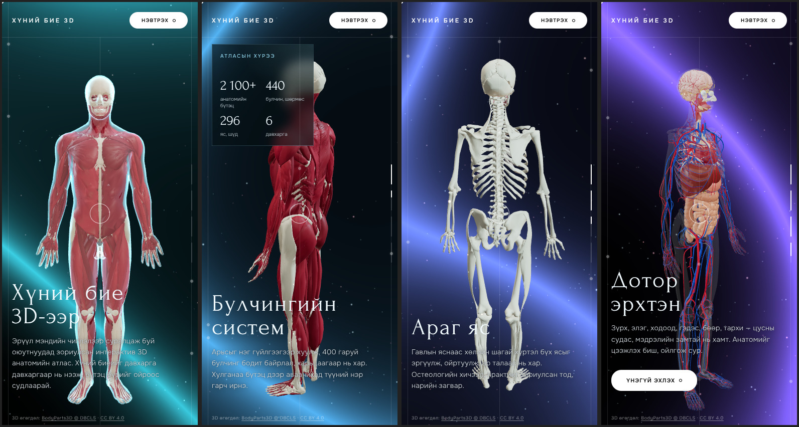

# Хүний бие 3D — anatomy landing page

A cinematic, scroll-driven landing page (in Mongolian) for a 3D anatomy atlas aimed at health-science
students. Scrolling orbits the camera 360° around a real anatomical model and peels it layer by layer:
skin → muscles → skeleton → organs, vessels and nerves. Hovering a structure (or tapping it on a phone)
shows its name.

Built with Next.js 16 (App Router), React 19 and three.js r160.





## Run

```bash
npm install
npm run dev        # http://localhost:3000
npm run build && npm start
```

## Where things live

| Path | What |
| --- | --- |
| `lib/content.ts` | All page copy (Mongolian), nav targets, layer names, credit line |
| `lib/anatomy-scene.ts` | three.js stage: model layers and their scroll-driven opacity, camera orbit, cells, wave backdrop, hover picking |
| `components/AnatomyLanding.tsx` | Overlay markup, animation loop, custom cursor, slides and progress |
| `components/SplitTitle.tsx` | Per-letter blur-up titles |
| `app/globals.css` | Styles, including the phone layout (≤ 900px) |
| `public/models/anatomy.glb` | The anatomy model (meshopt-compressed, ~5 MB) |
| `scripts/build-anatomy.mjs` | Rebuilds the model from source data |

Layer timing is in `layerOpacity()` in `lib/anatomy-scene.ts`; slide timing is `SLIDE_RANGES` in
`components/AnatomyLanding.tsx`.

## The model

`public/models/anatomy.glb` is generated from **BodyParts3D 4.0** (adult male reference anatomy), via
the simplified copy in [ashemag/human-atlas](https://github.com/ashemag/human-atlas). It has one mesh per
layer (`skin`, `muscles`, `skeleton`, `organs`, `vessels`, `nerves`) with per-structure colours, and a
`_PART` vertex attribute that indexes the structure names stored in each node's extras.

```bash
npm run build:anatomy   # downloads ~33 MB into .anatomy-cache/ on first run
```

Layer membership, colours and the triangle budget are at the top of the script. The dataset has no
lungs and only the caudate lobe and Couinaud segments of the liver, so the copy doesn't mention lungs.

## Licence and attribution

The anatomy data is **BodyParts3D, © The Database Center for Life Science, licensed under
[CC BY 4.0](https://creativecommons.org/licenses/by/4.0/)**
([licence page](https://dbarchive.biosciencedbc.jp/en/bodyparts3d/lic.html)). It was simplified,
recoloured and regrouped for this page. CC BY requires the credit line, which the page shows at the
bottom left (`credit` in `lib/content.ts`); keep it if you change the layout.
